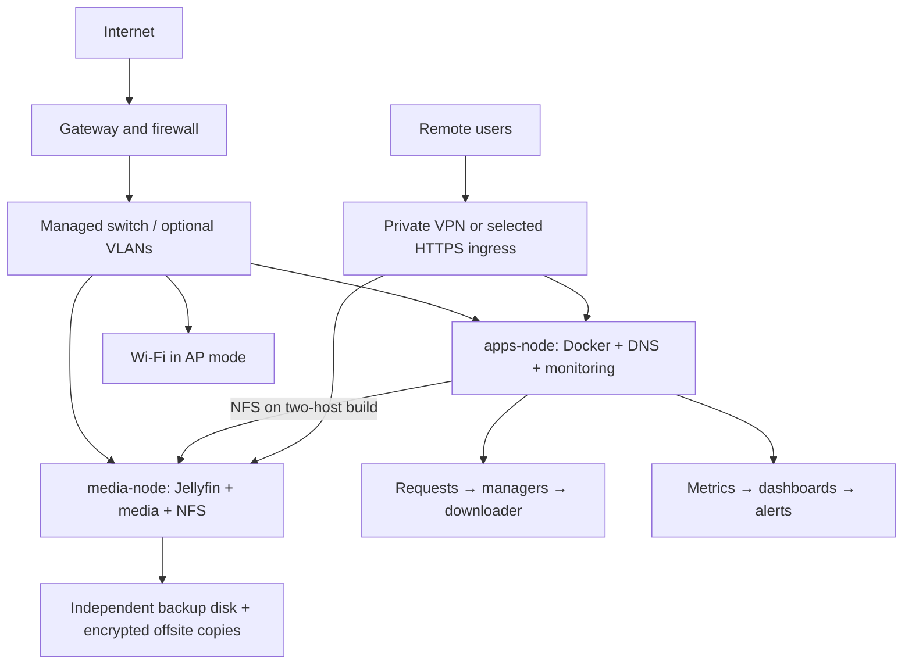

# Architecture and dependency order

## Choose one or two hosts

A single-host build is simpler: Jellyfin, containers and media share one machine. A two-host build keeps media and Jellyfin on media-node and applications on apps-node. It introduces NFS, numeric identity mapping and a dependency on network storage. Neither design is redundant by itself.

The diagram shows roles, not real addresses or cabling. Choose LAN and management subnets in your worksheet; do not copy someone else's address plan. Start flat if you cannot yet administer VLAN routing safely. VLAN segmentation is optional; storage health and backups are not.

## Data layout

Use `/srv/media-data` on the media host for a filesystem root and `/srv/media-data` on the apps host for its NFS mount. Inside applications bind that entire tree to `/data`. Under it use `downloads/`, `media/movies/`, `media/tv/` and `media/music/`. Downloads and destination media must be on the same filesystem for hardlinks. Configuration databases stay on each host's local SSD under `/opt/media-lab/config/`; do not place live SQLite databases on NFS.

## Build gates

| Gate | Evidence required before proceeding |
| --- | --- |
| Host/network | Console access, stable IPs, correct time, SSH and working DNS |
| Storage | Correct disk identity, healthy connection, intended mount and permissions |
| Apps | Local logins secured; configuration persistent across recreation |
| Integrations | One authorized sample travels request → approval → download → import → playback |
| Remote | Valid TLS, expected authentication, management interfaces remain private |
| Protection | Independent backup, checked manifest and isolated restore |
| Operations | Missing/unhealthy/backup failure alerts actually reach an operator |

Install backups early, before investing heavily in configuration. Return to the backup chapter after adding each module. Do not start public access merely because a container reports Healthy.
